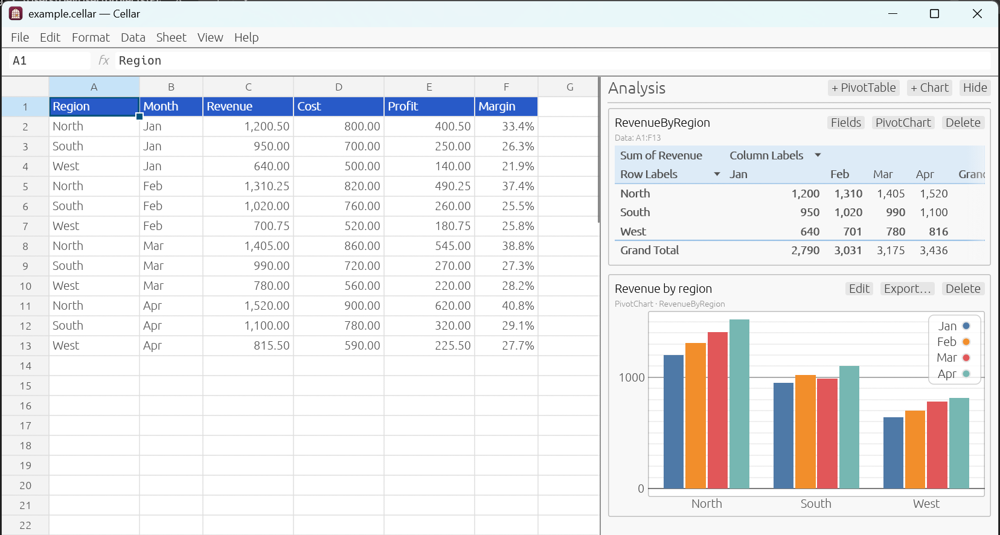

# Cellar

A desktop spreadsheet whose workbooks are plain, readable text.
{: .fs-6 .fw-300 }

Excel-style formulas, tables, PivotTables and charts, saved in a file you
can read, compare, merge and keep in git. For macOS, Windows and Linux.

[Get started](getting-started.md){: .btn .btn-primary .fs-5 .mb-4 .mb-md-0 .mr-2 }
[Download](https://github.com/haderlka/Cellar/releases){: .btn .fs-5 .mb-4 .mb-md-0 }

## Why Cellar?

Spreadsheets end up holding important data, but `.xlsx` files are zipped
XML: you can't see what changed between two versions, and two people
editing the same workbook can't merge their work. Cellar keeps every
workbook in a `.cellar` file:

- **Readable.** One line per cell, in row and column order, with only the
  settings that differ from the defaults.
- **Stable.** Saving an unchanged workbook writes a byte-identical file, so
  version control only shows real edits.
- **Mergeable.** Edits to different cells touch different lines and merge
  cleanly.

Cellar works like Excel where it can: the same formulas, the same keyboard
shortcuts, the same menus. If you know Excel, you already know most of
Cellar.

## This guide

| Page | What it covers |
|---|---|
| [Getting started](getting-started.md) | Installing, the window, your first workbook |
| [Entering and editing](editing.md) | Typing, selecting, filling, copy and paste, find and replace, comments, links |
| [Formatting](formatting.md) | Number formats, bold and colours, conditional formatting, column widths |
| [Formulas](formulas.md) | Writing formulas, references, names, formula help, tracing |
| [Function reference](functions.md) | Every function Cellar knows |
| [Tables and data tools](data.md) | Tables, sort, filter, remove duplicates, validation, goal seek |
| [PivotTables](pivot-tables.md) | Summarising data in the sidebar |
| [Charts](charts.md) | Charts, PivotCharts and in-cell sparklines |
| [Sheets and view](sheets-and-view.md) | Sheet tabs, freeze panes, hiding, zoom |
| [Files](files.md) | Opening, saving, importing, exporting, printing, the `.cellar` format |
| [Keyboard shortcuts](shortcuts.md) | All shortcuts in one table |
| [Differences from Excel](excel-differences.md) | What works differently, and what is missing |

## Credits

Cellar's formula language, calculation engine and workbook model come from
[tshts](https://github.com/SamuelSchlesinger/tshts) by Samuel Schlesinger.
Cellar adds the graphical interface, PivotTables, charts, the canonical
file layout and the Excel converter.
